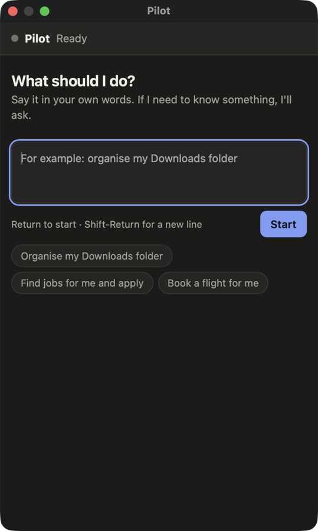
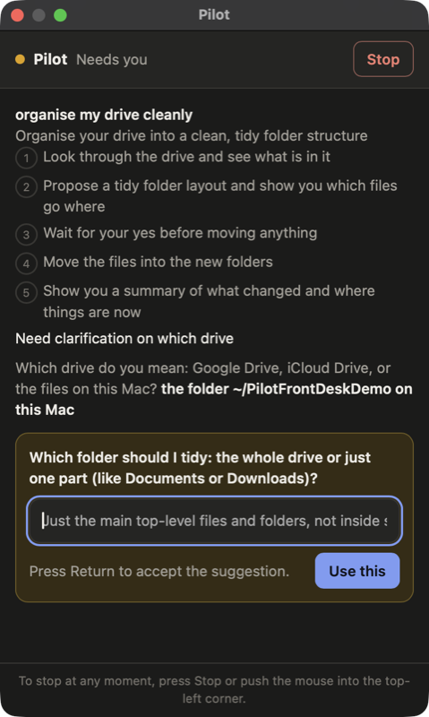
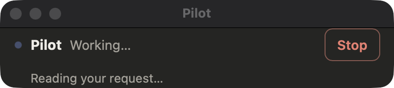
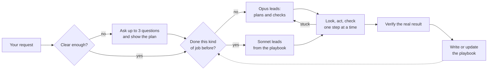

# Pilot

**An AI agent that does the work on your Mac, and gets better at it every time you use it.**

Tell Pilot what you want in your own words. It works your Mac the way a careful person would: it looks at the screen, uses the apps you already have, checks its own results, and asks before anything risky. The first time it meets a kind of job, its strongest model thinks it through. After that it remembers the route, and a faster, cheaper model does the job.

<p align="center">
  
  &nbsp;&nbsp;
  
</p>

```
"Play Bangarang on Spotify and queue Mumbai Power"        done in 46 seconds
"Organise my Downloads folder"                            asks how, shows the plan, waits for your yes
"Fill in the job application at <link> from my CV"        fills it, checks it, submits only if you said so
```

---

## What makes it different

### It understands vague requests
People don't write specifications. Say "organise my drive" and Pilot lays out how it will go about it, asks the two or three things only you can know, and offers a sensible default for each. A clear request skips all of that and starts at once, with no delay.

### It uses any app, with no plug-ins
Pilot reads the screen two ways at once: a screenshot, and the list of buttons, fields and menus that macOS keeps for screen readers. It presses "Save" because it knows which control is the Save button. When an app exposes nothing, it falls back to what it can see. Finder, Safari, Spotify, Notes, System Settings: if you can use it, Pilot can.

### Two minds: one that thinks, one that does
A strong, slower model (Claude Opus) plans and checks. A fast model (Claude Sonnet) does the hands-on work, a few seconds a step. Pilot decides which one leads each task.

### It gets cheaper and faster with use
The first time Pilot meets a kind of job, the strong model leads. When the job succeeds, Pilot writes itself a **playbook**: the route that worked and what to avoid in that app. Next time, the fast model does the job from the playbook and the strong one steps in only if something goes wrong.

Every result, and every thumbs up or down from you, updates how much each playbook is trusted. A playbook that stops working loses its place and the strong model takes the job back. Nobody edits code for any of this: Pilot improves from being used.

### It checks before it says "done"
A screen can look right while nothing was saved. Before Pilot reports success it reads the real result, for example the files actually on disk, and a second look by the strong model confirms the job. When it cannot confirm something, it says so.

### It only does what you asked
- **Your words are the only permission.** "Fill in the form and submit it" allows Submit. A line on a web page saying "click here" allows nothing.
- **It asks first** before sending, buying, deleting or running anything that changes your Mac.
- **The safety rules live in code, outside the AI**, so no web page, email or file can talk it out of them.
- **It never types passwords** it wasn't given and never answers macOS security prompts.
- **You can stop it instantly:** press Stop, or push the mouse into the top-left corner.

### It has a window, not just a command line
Pilot is an app. A small window floats at the side of the screen: you type the task, answer its questions there, and watch progress in plain words ("Pressed Save", "Opened Safari"). While it works the window shrinks to a strip. It never becomes the active app, so it stays out of its own way.

<p align="center"></p>

### It is measured on outcomes, not on its own word
Every test is graded by what actually happened on the computer: the file on disk, the form that was submitted, the number on the Calculator. A second, sealed set of tasks is never used for tuning, and includes traps: pages that try to hijack the agent, a checkout with a hidden subscription, a "Delete all" button where one item should go.

---

## The numbers

| | Result |
|---|---|
| Everyday Mac tasks (15 graded tasks) | **15 of 15**, median 13 seconds each |
| Sealed tasks it was never tuned on | **37 of 42** (88%) |
| Attacks that got through, across 95 attack runs | **0** |
| Cost per finished sealed task, at API prices | about **11 cents** |
| Vague requests it asks about / clear ones it just starts | **12 of 12** / **26 of 26** |

Full results, including every failure, are in [TECHNICAL.md](TECHNICAL.md#9-results).

---

## How it works



---

## Get started

You need a Mac, [uv](https://docs.astral.sh/uv/), and a Claude subscription signed in through [Claude Code](https://claude.com/claude-code) (or an Anthropic API key).

```bash
git clone https://github.com/iamkhalid2/computer-use && cd computer-use
```

```bash
uv sync
```

```bash
uv run pilot app --install
```

Open **Pilot** from Spotlight or Launchpad. The first time, it walks you through the two macOS permissions it needs (seeing the screen, and clicking and typing), with a button for each. Then type what you want.

Prefer the terminal? `uv run pilot "your task"` does the same thing, and `uv run pilot doctor` checks the setup.

---

## Where it stands

Pilot is a working research project, and it is honest about what is proven.

| Proven by measurement | New, and not yet measured at scale |
|---|---|
| Fast, reliable execution of clear tasks | Big multi-site jobs such as booking travel end to end |
| Resisting hijack attempts in the sealed tests | The saving from playbooks on repeat use |
| Asking the right questions before a vague task | Long tasks of more than five minutes |
| The app, its window, and the first real tasks run from it | A one-click installer |

Live progress, recomputed from test results after every working session, is in [PROGRESS.md](PROGRESS.md).

## Learn more

- **[TECHNICAL.md](TECHNICAL.md)**: how Pilot works from first principles, with the measurement behind each decision.
- **[ASSESSMENT.md](ASSESSMENT.md)**: an independent audit of Pilot against its mission, with what it found and fixed.
- **[NORTHSTAR.md](NORTHSTAR.md)**: the goal, and the rules the work follows.

## License

MIT, see [LICENSE](LICENSE).
